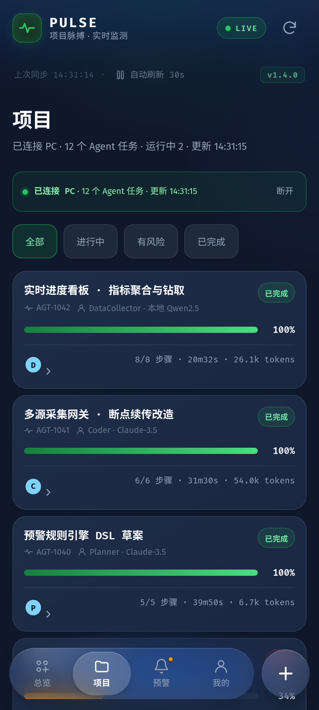

# PULSE · Cross-Device Agent Task Progress Monitor


One window on the PC: a pairing QR code is built right into the app and Agent task progress is listed live. The Android app connects by scanning the QR code, views progress in real time, and can **pause / resume / retry** tasks. Pure LAN — no cloud, no accounts.

[中文说明](README.md)

## Screenshots

| Desktop (lightweight single window) | Android |
|---|---|
|  |  |

## Quick Start

1. **PC**: download the single-file binary from [Releases](../../releases) and run it — the QR code shows right in the window
2. **Android**: install the APK from Releases
3. Tap "Connect PC" in the app and scan (or enter address + token manually)

## Run / Build from Source

```bash
# PC (Python 3.10+, pip install PySide6 segno)
python desktop/pulse_desktop.py

# Package the PC binary
bash desktop/build_linux.sh          # dist/PULSE_Desktop (Windows: build_exe.bat)

# Android APK (requires Android SDK 35)
bash mobile/android/build.sh         # releases/PULSE_v1.6.0.apk
```

## Verification & Releases

Six suites with **174 assertions** in total (`desktop/verify_*.py`, `mobile/verify_link.py`) run automatically in CI on every push; pushing a `v*` tag builds and publishes a Release (binary + APK) automatically.

```bash
cd desktop && QT_QPA_PLATFORM=offscreen python3.12 verify_desktop.py   # 11 checks
```

## Notes

- Data is simulated locally by default; `--source http` accepts real Agent events via `POST /api/events` (protocol documented in code)
- The pairing token persists at `~/.pulse/pair_token` (mode 600) — phones survive PC restarts without re-pairing
- Known limits: QR scanning depends on the device WebView camera permission (falls back to manual input); the APK is demo self-signed
