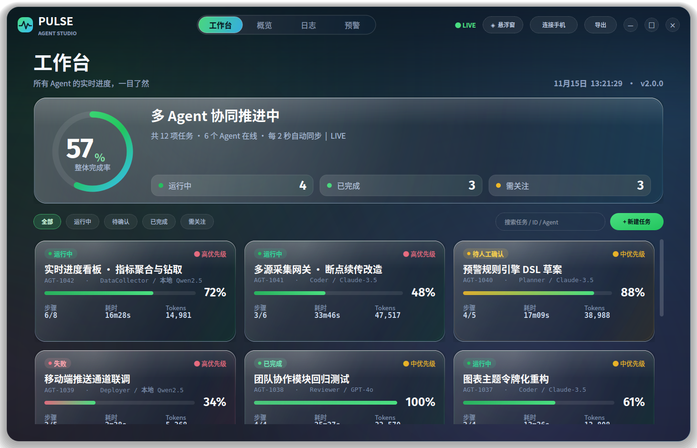
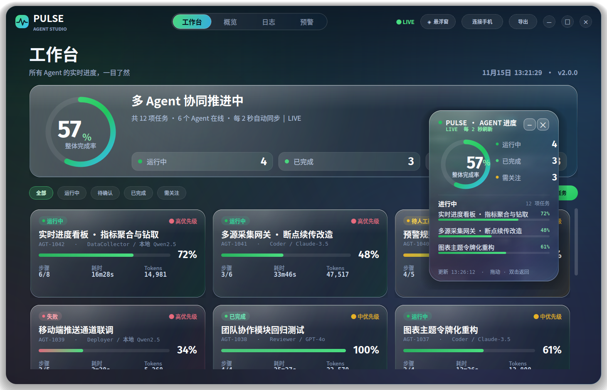
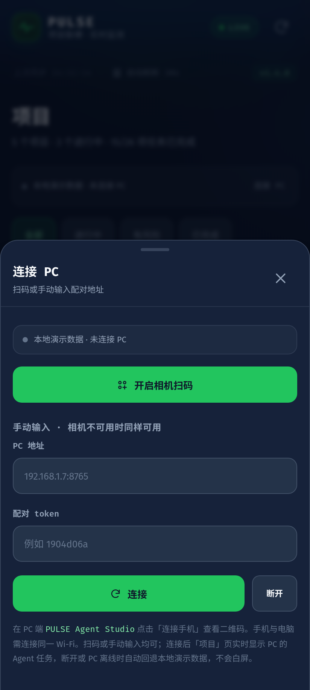
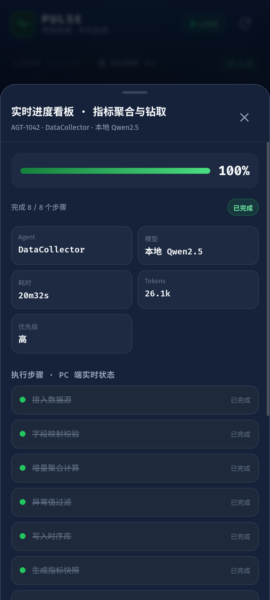

# PULSE · Cross-Device Agent Task Progress Monitor

> **PULSE** is a two-sided prototype for monitoring Agent task progress. The **desktop app** is a native Qt Widgets workstation (branded glass UI + a liquid-glass floating widget). The **Android app** is an offline WebView application that connects to the PC over the same LAN — **by scanning a QR code or entering the address manually** — to view the PC's Agent task progress in real time.

[中文说明](README.md) · [Back to top](#contents)

---

## Contents

- [Overview](#overview)
- [Screenshots](#screenshots)
- [Architecture](#architecture)
- [Modules](#modules)
- [Data Contract (Pairing Protocol)](#data-contract-pairing-protocol)
- [Tech Stack](#tech-stack)
- [Repository Layout](#repository-layout)
- [Quick Start](#quick-start)
- [Building](#building)
- [Verification](#verification)
- [Design System](#design-system)
- [Version History](#version-history)
- [Known Limitations & Roadmap](#known-limitations--roadmap)
- [License](#license)

---

## Overview

| Side | Form | Current version | Responsibility |
|---|---|---|---|
| **Android** | Offline WebView single-file app (`PULSE_v1.4.0.apk`) | `1.4.0` / `versionCode 10` | Scan a QR code to connect to the PC and render the PC's Agent tasks onto the "Projects" page |
| **Desktop** | Native desktop app (PySide6 / Qt Widgets) | `2.0.0` | Manage and publish Agent task progress, host a read-only LAN service + QR code, and provide a toggleable floating widget |

The goal is a complete chain: **PC starts a service → generates a QR code → phone scans and connects → pulls a real task snapshot → renders it**. The two UIs are designed independently and decoupled through a thin read-only HTTP interface: the PC publishes a task snapshot as JSON, and the Android app pulls and maps it into its own project model.

> **Important**: data on both sides is currently **local demo data** (12 tasks from `seed_tasks()`, advanced every 2s by `QTimer`/`random`). **No real agent event source or backend is connected yet**. This chain demonstrates cross-device sharing and presentation, not production data collection. See [Known Limitations](#known-limitations--roadmap).

---

## Screenshots

**Desktop · Branded glass workstation (v2.0.0)**

| Workbench | Liquid-glass floating widget (over the app) |
|---|---|
|  |  |

The floating widget supports expanded / collapsed capsule states: [expanded](docs/screenshots/desktop-overlay-expanded.png) · [collapsed](docs/screenshots/desktop-overlay-collapsed.png). Other pages: [Overview](docs/screenshots/desktop-overview.png) · [Logs](docs/screenshots/desktop-logs.png) · [Alerts](docs/screenshots/desktop-alerts.png) · [Pairing QR dialog](docs/screenshots/desktop-pairing-qr.png).

**Android (v1.4.0)**

| Projects page after connecting (12 PC tasks) | Pairing panel | Remote task detail sheet |
|---|---|---|
|  |  |  |

When disconnected, local demo data is shown: [local projects](docs/screenshots/mobile-projects-local.png) · [overview](docs/screenshots/mobile-overview.png).

---

## Architecture

```
┌──────────────────────────────────┐         ┌──────────────────────────────────┐
│  Desktop  PULSE Agent Studio 2.0  │         │  Android  PULSE v1.4.0           │
│  (PySide6 / Qt Widgets, native)   │         │  (offline WebView, single file)   │
│                                  │         │                                  │
│  seed_tasks() ── tick() every 2s ─┤         │  Pairing: QR scan / manual input  │
│         │                        │         │         │                        │
│         ▼                        │         │         ▼                        │
│  PairServer (ThreadingHTTPServer) │  HTTP   │  NativeBridge.httpGet()        │
│  0.0.0.0:8765                    │◄────────┤  HttpURLConnection on a thread │
│   /api/health                    │  JSON   │  → evaluateJavascript callback  │
│   /api/tasks?token=…             ├────────►│  window.PulseLink._onData()     │
│         │                        │         │         │                        │
│  segno QR + "Connect phone" dlg  │  scan   │  applyRemoteData() field mapping │
│                                  ├────────►│  activeProjects() single source │
│  GlassOverlay liquid-glass widget│         │  Projects / Overview / Detail     │
└──────────────────────────────────┘         └──────────────────────────────────┘
          Same Wi-Fi LAN · one-time token auth · auto fallback to local data on disconnect
```

Key design decisions:

- **Network requests go through the native bridge, not the WebView.** The Android page is loaded from `file:///android_asset/index.html`; a direct `fetch(http://…)` would hit cross-origin, cleartext HTTP, and mixed-content restrictions at once. Java's `NativeBridge.httpGet()` performs the request on a background thread and returns the result via `evaluateJavascript`.
- **The two data models are decoupled.** The PC uses `Task{status, steps, agent, model, tokens…}`; Android uses `Project{tasks[]…}`. `applyRemoteData()` maps fields on connect, and the render layer consistently reads `activeProjects()` — so falling back on disconnect is just one switch.
- **The token is regenerated on every launch.** No long-lived credential. The app silently reconnects to the last address on startup; if it fails, it stays on local data without bothering the user.

---

## Modules

### Desktop (`desktop/`)

| Module | File | Responsibility |
|---|---|---|
| Shared data core | `pulse_core.py` | `Task` dataclass, `seed_tasks()`, status enums, design tokens, font loading, `summarise()` |
| Liquid-glass engine | `pulse_glass.py` | `GlassCard` (workbench cards), `GlassOverlay` (floating widget); layered glass material drawn with `QPainter` |
| Main UI | `pulse_studio.py` | Four pages (Workbench / Overview / Logs / Alerts), custom title bar, Aurora background, floating-widget integration, entry point |
| Pairing service | `pulse_pair_server.py` | Read-only LAN HTTP service, token auth, QR generation, "Connect phone" dialog |
| Legacy fallback | `pulse_agent_console.py` | v1.3.0 admin-style UI, kept as a rollback baseline (reference only) |

- **Main UI**: frameless rounded window, custom title bar, animated Aurora glow, Hero completion ring, Bento task card flow (responsive 1–3 columns), chip filters + search, live progress, CSV export.
- **Liquid-glass floating widget** (title-bar "◈ Floating widget" or `Ctrl+O`): procedural Aurora blobs + screen-grab blur transmission + translucent glass gradient + specular highlight edge + pointer-following inner highlight + layered soft shadow. Supports dragging, expanded ↔ collapsed capsule spring animation, right-click menu (always-on-top / reduced motion / back to main window / close), double-click to return. Data is synced from the main window every 2s.
- **Pairing service**: `ThreadingHTTPServer` on `0.0.0.0:8765`, read-only endpoints, thread-safe (snapshot string swapped under a lock, never sharing a mutable object with `tick()`), graceful startup failure and shutdown.

### Android (`mobile/`)

| Module | File | Responsibility |
|---|---|---|
| Page (single source of truth) | `index.html` | All CSS/JS inlined, SVG sprite, 4 views, charts, pairing panel, plus an inlined `jsQR 1.4.0` decoder |
| Fonts | `fonts/*.woff2` | 6 Fira Sans / Fira Code fonts, fully offline |
| Native container | `android/src/.../MainActivity.java` | WebView setup, `NativeBridge` (vibrate / version / toast / `httpGet`), CAMERA runtime permission, `onPermissionRequest` allowlist |
| Manifest | `android/AndroidManifest.xml` | `VIBRATE` / `INTERNET` / `CAMERA` permissions, `usesCleartextTraffic`, `versionCode 10` |
| Build script | `android/build.sh` | Pure CLI `aapt2 → javac → d8 → zipalign → apksigner`, no Gradle / Android Studio |

- **UI material**: an iOS-style feathered frosted-glass bottom tab bar (transparent edges, blurred highlighted center) and a top app bar with a gradient blur and no hard dividing line. These were refined across many iterations; the v1.4.0 pairing feature **did not change any existing layout or style rule**.
- **Pairing flow**: entry via the "Me" page or the status strip on the Projects page; QR scan with the inlined jsQR decoder + `getUserMedia` frame capture, **or manual entry of `IP:port` + token**. If the camera is unavailable, a clear hint is shown and the input is focused — never a silent failure, never a blank screen.
- **Data mapping**: 6 PC statuses (`running/queued/review/paused/failed/done`) → the existing 3 filter buckets, keeping the `status_label` Chinese badge; four-state `steps`, `agent/model`, `elapsed/tokens/priority/logs` are all retained in the detail sheet.
- **Robustness**: remote tasks are read-only; two consecutive failures or PC offline triggers an automatic fallback to local demo data; `REMOTE.suppressed` prevents a late in-flight response from re-connecting after disconnect; the three sheets are mutually exclusive.

---

## Data Contract (Pairing Protocol)

Protocol version `PAIR_VERSION = 1.3.0`, **decoupled from the UI versions** (response fields have not changed since introduction, so it stays stable for backward compatibility). Changing the response shape requires bumping this value and updating parsers on both sides.

| Endpoint | Method | Description |
|---|---|---|
| `/api/health` | GET | Health check, returns `{ok, service, version, port, token_required, requests, endpoints}`, no token needed |
| `/api/tasks?token=<token>` | GET | Task snapshot JSON, requires a valid token |
| `/api/tasks` | OPTIONS | Preflight, returns `204` with CORS headers |
| Any other path | — | `404` |

- Invalid or missing token → `401`; response headers `Access-Control-Allow-Origin: *` and `Cache-Control: no-store`.
- `/api/tasks` response shape:

```json
{
  "ok": true,
  "generated": "14:22:49",
  "summary": { "total": 12, "running": 3, "done": 7,
               "need_attention": 2, "completion_rate": 76 },
  "server": { "host": "192.168.1.7", "port": 8765, "token": "…", "version": "1.3.0" },
  "tasks": [
    {
      "id": "AGT-1042", "name": "Realtime progress dashboard · metric aggregation",
      "agent": "DataCollector", "model": "Local Qwen2.5",
      "status": "done", "status_label": "Completed", "progress": 100,
      "steps": [ { "label": "Connect data source", "state": "done" } ],
      "steps_done": 8, "steps_total": 8,
      "elapsed": 1403, "elapsed_text": "23m23s", "tokens": 31600,
      "priority": "high", "started": "…", "updated": "…",
      "logs": [ "…" ]
    }
  ]
}
```

Status enum: `running` · `queued` · `review` · `paused` · `failed` · `done`; step states: `done / active / blocked / todo`.

---

## Tech Stack

| Side | Stack |
|---|---|
| Desktop | Python 3.12, PySide6 / Qt Widgets (native widgets, **no HTML / WebView**), `segno` (QR), `zxingcpp` + Pillow (verification), PyInstaller (one-file packaging) |
| Android | Java (WebView container), single-file HTML/CSS/JS, inlined `jsQR 1.4.0`, Android SDK build-tools `35.0.0` (`aapt2 / d8 / zipalign / apksigner`), JDK `javac` |
| Design | `ui-ux-pro-max-skill` generated MASTER design system (Code dark `#0F172A` + run green `#22C55E`, Fira Sans / Fira Code, Bento Grid, 44px touch targets, reduced-motion) |

---

## Repository Layout

```
pulse-agent-monitor/
├── README.md                   # Chinese documentation
├── README.en.md                # This file
├── .gitignore
├── docs/
│   └── screenshots/            # 13 runtime screenshots (8 desktop + 5 mobile)
├── mobile/
│   ├── index.html              # Single-file page (inlined CSS/JS/jsQR)
│   ├── fonts/                  # 6 woff2 fonts
│   ├── android/
│   │   ├── AndroidManifest.xml
│   │   ├── build.sh            # Pure CLI build
│   │   ├── src/com/pulse/app/MainActivity.java
│   │   └── res/               # icons, colors, strings, styles
│   ├── design-system/pulse/    # MASTER.md + pages/dashboard.md
│   └── verify_link.py          # Mobile pairing E2E (32 checks)
├── desktop/
│   ├── pulse_core.py           # Shared data core
│   ├── pulse_glass.py          # Liquid-glass engine + floating widget
│   ├── pulse_studio.py         # Main UI + entry point (v2.0.0)
│   ├── pulse_pair_server.py    # Read-only LAN pairing service
│   ├── pulse_agent_console.py  # Legacy UI (rollback baseline)
│   ├── verify_pair.py          # Pairing contract checks (22)
│   ├── verify_studio.py        # Desktop functional checks (30)
│   ├── requirements.txt        # Runtime dependencies
│   ├── requirements-dev.txt    # Dev / verification dependencies
│   ├── start.sh / start.bat    # One-command launchers
│   ├── build_linux.sh / build_exe.bat  # One-file packaging
│   ├── resources/fonts/        # 6 TTF fonts
│   └── design-system/PC-MASTER.md
└── releases/
    └── PULSE_v1.4.0.apk        # Prebuilt signed APK (v2/v3 verified)
```

---

## Quick Start

### 1. Launch the desktop app

Requirements: Python 3.12 (3.11/3.10 also work; the launcher auto-detects), Linux / macOS / Windows.

```bash
cd desktop
python3.12 -m pip install -r requirements.txt
python3.12 pulse_studio.py
# or the one-command launcher (installs dependencies automatically):
./start.sh          # Windows: start.bat
```

Then: click "Connect phone" (or `Ctrl+M`) for the QR dialog; "◈ Floating widget" (or `Ctrl+O`) toggles the liquid-glass overlay.

### 2. Install the Android app

- Install [`releases/PULSE_v1.4.0.apk`](releases/PULSE_v1.4.0.apk) directly (v1/v2/v3 signature, `zipalign`, and integrity verified); or
- Build it yourself per [Building](#building).

> This APK is signed with a **demo debug keystore generated locally**. Rebuilding generates a new keystore and therefore a different signature — uninstall the previous version before installing.

### 3. Connect via QR code (PC and phone on the same Wi-Fi)

1. On the PC, click "Connect phone" — a QR code, the plaintext address, and a one-time token are shown.
2. On the phone, open the app → "Me" → "Connect PC", or tap the status strip on the Projects page.
3. **Scan**: tap "Start camera scan" and point at the PC's QR code (auto-fills and connects); or
   **Manual**: enter `IP:port` (e.g. `192.168.1.7:8765`) and the token → tap "Connect".
4. Once connected, the Projects page switches to the PC's 12 Agent tasks (with Chinese status badges) and the overview completion rate comes from the PC snapshot. Tap a card for details (four-state steps, Agent/model, elapsed, tokens, recent logs; read-only).
5. Tap "Disconnect" or take the PC offline — the app falls back to local demo data automatically.

Automation / debug flags (desktop main program): `--screenshot`, `--page`, `--size`, `--overlay-shot`, `--overlay-collapsed-shot`, `--pair-info`, `--pair-qr`, `--pair-shot`, `--serve-seconds`.

---

## Building

### Android

Requires Android SDK `build-tools;35.0.0`, `platforms;android-35`, and a JDK (`javac`). Default `ANDROID_HOME=/opt/android-sdk`, overridable via environment variable.

```bash
cd mobile/android
bash build.sh
# Output: ../../releases/PULSE_v1.4.0.apk by default
# Override with PULSE_APK_OUT=/path/out.apk
# Override the demo signing password with PULSE_KS_PASS=<password>
```

The script generates a local debug keystore on the **first build** (the private key is excluded from version control, see `.gitignore`). The toolchain is pure CLI — no Gradle / Android Studio.

### Desktop

```bash
cd desktop
python3.12 -m pip install -r requirements.txt pyinstaller
bash build_linux.sh          # Linux: dist/PULSE_Agent_Studio
# Windows: build_exe.bat     → dist/PULSE_Agent_Studio.exe
```

The result is a Python-free one-file executable, verified to launch independently from a temporary directory (including the floating widget).

---

## Verification

Three reproducible verification suites, all passing before release:

| Script | Coverage | Result |
|---|---|---|
| `desktop/verify_pair.py` | Service startup, health, field contract, token auth (invalid/missing → 401), CORS, no-store, 404, OPTIONS 204, live updates, real QR decoding | **22 / 22** |
| `desktop/verify_studio.py` | Four pages, 3-column grid, filter/search, new task, tick advancement, overlay toggle/collapse/drag/reduced-motion/live sync/close write-back, pairing service import | **30 / 30** |
| `mobile/verify_link.py` | Chromium CDP loads the real `index.html` from the APK + simulated `NativeBridge.httpGet` + a **real PC service**: disconnected state, 12 tasks after connecting, Chinese badges, progress parity, overview rate, filter counts, sheet steps/logs/read-only, sheet exclusivity, disconnect fallback, late-response suppression, inlined jsQR decoding the real QR address, progress-bar fill, zero metric-card overflow | **32 / 32** |

```bash
# Pairing contract (standalone)
cd desktop && python3.12 verify_pair.py

# Desktop functions (offscreen)
cd desktop && QT_QPA_PLATFORM=offscreen python3.12 verify_studio.py

# Mobile loop: start the PC service and extract the APK page first,
# see the header comment in verify_link.py
python3.12 mobile/verify_link.py --info <pair_info.json> --qr <qr.png>
```

Dev/verification dependencies are in `desktop/requirements-dev.txt` (`zxingcpp`, `Pillow`, `websocket-client`); `verify_link.py` additionally needs a system Chromium for CDP. Before release we also ran: APK v2/v3 signature verification, `zipalign -c`, `unzip -t`, permission/cleartext flag checks, inlined JS `node --check`, and an isolated launch of the packaged desktop binary.

---

## Design System

- Mobile: [`mobile/design-system/pulse/MASTER.md`](mobile/design-system/pulse/MASTER.md) · [`pages/dashboard.md`](mobile/design-system/pulse/pages/dashboard.md) (with v1.2.0 → v1.4.0 UI override and bug-fix history)
- Desktop: [`desktop/design-system/PC-MASTER.md`](desktop/design-system/PC-MASTER.md) (§9 documents the v2.0.0 glass workbench and the liquid-glass material engine)

Base tokens follow the Code dark + run green palette; the desktop prefers `Noto Sans CJK SC` for Chinese and Fira for numerals/monospace; every status is encoded in two channels (dot + text).

---

## Version History

| Version | Side | Content |
|---|---|---|
| v1.2.5 | Mobile | UI finalized: iOS feathered frosted-glass tab bar, gradient-blur top bar, progress-ring fix, single-file inlining against stale cache |
| v1.3.0 | Desktop + Mobile | Desktop hosts a read-only LAN service + QR code; mobile gains permissions and the `httpGet` bridge, opening the data channel (no UI change) |
| v2.0.0 | Desktop | Full rewrite into a branded glass workstation; adds the toggleable liquid-glass floating widget |
| v1.4.0 | Mobile | QR/manual pairing entry, PC-to-Projects data mapping, read-only protection, disconnect fallback, sheet exclusivity — the version shipped in this repository |

---

## Known Limitations & Roadmap

**Known limitations (stated honestly)**

1. Both sides use local `seed_tasks()` + `random` advancement with **no real agent event source or backend** — this is not a production collection system.
2. QR scanning relies on Android WebView granting `getUserMedia` to a `file://` page; some devices or older WebView versions may fail — in that case it automatically degrades to manual entry, so the capability is never lost. This branch needs on-device confirmation.
3. The floating widget's real desktop transmission relies on `QScreen.grabWindow(0)`; some Linux compositors / remote desktops may return no usable image, in which case it degrades to procedural Aurora (visually complete, but without real background transmission).
4. The token is regenerated on every launch; the app silently reconnects to the last address on startup and stays on local data if it fails.
5. Windows exe packaging, on-device CAMERA permission / rear-camera frame capture, and multi-monitor placement have not been validated on real hardware (scripts and logic are ready).

**Roadmap**

| Priority | Direction | Description |
|---|---|---|
| P0 | Data loop | Unify fields and status enums across both sides, use a local JSON / SQLite as the single source of truth, replace demo generation; acceptance: changing one progress value updates both sides |
| P1 | Real collection | Replace `tick()`'s `random` with agent event driving; wire threshold rules into the existing Alerts page |
| P2 | Notifications & collaboration | Add desktop notifications, team collaboration, and escalation |
| P3 | Device / cross-platform validation | On-device WebView compatibility (backdrop-filter, safe-area, caching), Windows exe, multi-monitor; freeze the regression checklist |

---

## License

No open-source license has been specified for this repository yet. If you intend to open-source it, please add a `LICENSE` file (e.g. MIT / Apache-2.0). The demo signing key and prebuilt APK are for prototyping only.
