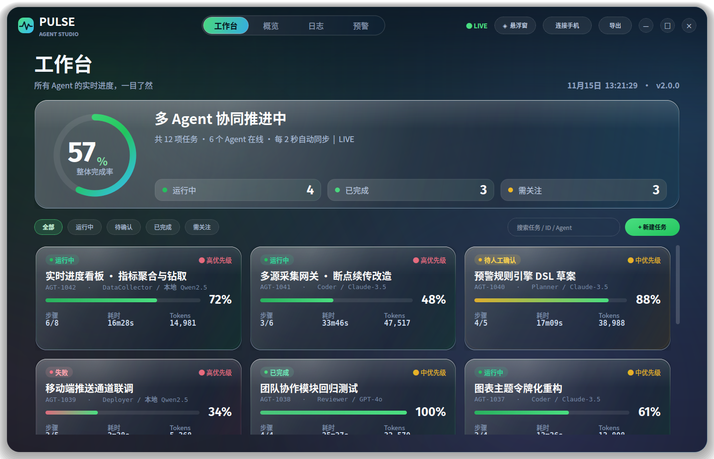
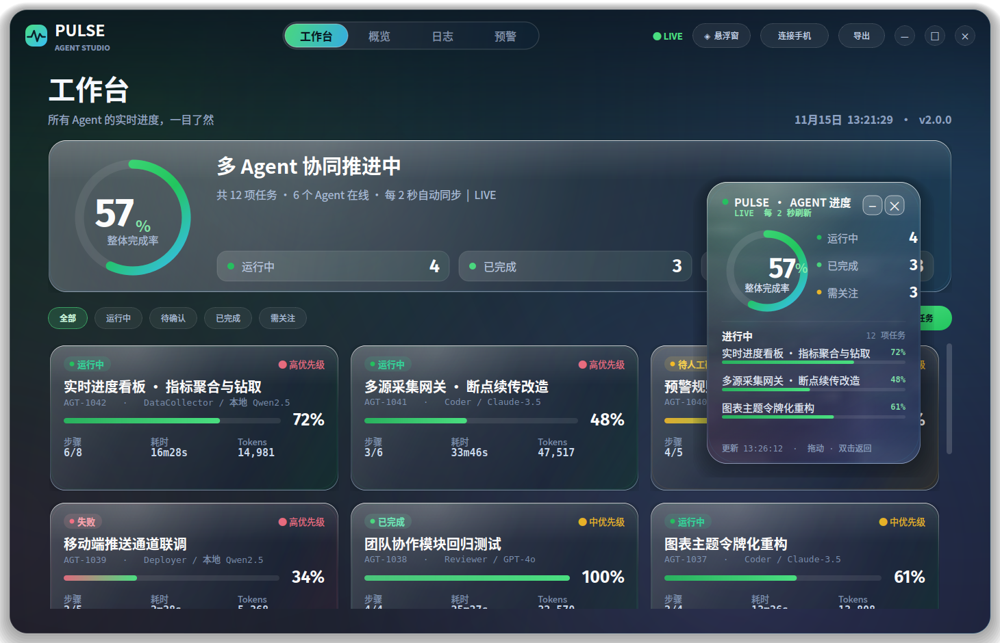
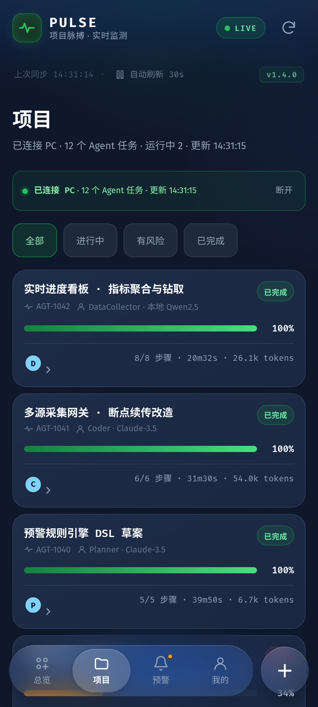
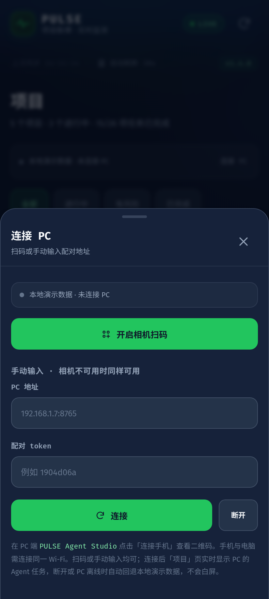
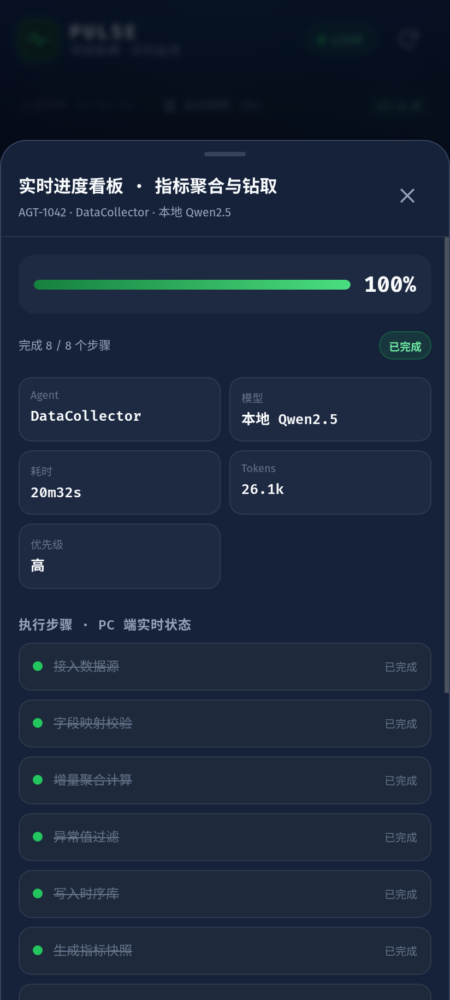

# PULSE · 双端 Agent 任务进度监测


> **PULSE** 是一个双端的 Agent 任务进度监测原型：**PC 端**是原生 Qt Widgets 桌面工作台（品牌化玻璃界面 + 液态玻璃悬浮窗），**安卓端**是离线 WebView 应用，通过**扫码或手动输入地址**连接同一局域网的 PC，实时查看 PC 端的 Agent 任务进度。

[English README](README.en.md) · [返回目录](#目录)

---

## 目录

- [项目简介](#项目简介)
- [界面预览](#界面预览)
- [整体架构](#整体架构)
- [功能模块](#功能模块)
- [数据契约（配对协议）](#数据契约配对协议)
- [技术栈](#技术栈)
- [目录结构](#目录结构)
- [快速开始](#快速开始)
- [构建](#构建)
- [验证](#验证)
- [设计系统](#设计系统)
- [版本历史](#版本历史)
- [已知限制与后续路线图](#已知限制与后续路线图)
- [许可](#许可)

---

## 项目简介

| 端 | 形态 | 当前版本 | 一句话职责 |
|---|---|---|---|
| **安卓端** | 离线 WebView 单文件 App（`PULSE_v1.4.0.apk`） | `1.4.0` / `versionCode 10` | 扫码连接 PC，把 PC 的 Agent 任务进度渲染到「项目」页 |
| **PC 端** | 原生桌面程序（PySide6 / Qt Widgets） | `2.0.0` | 管理并推送 Agent 任务进度，起局域网只读服务 + 二维码，提供可开关的悬浮窗 |

设计目标是打通一条**「PC 起服务 → 二维码 → 手机扫码连接 → 拉取真实任务快照 → 渲染」**的完整链路。两端 UI 各自独立设计，通过一层很薄的 HTTP 只读接口解耦：PC 端把任务快照发布为 JSON，安卓端按需拉取并映射成自己的项目模型。

> **重要说明**：两端的数据目前都是**本地演示数据**（`seed_tasks()` 生成 12 条任务，`QTimer`/`random` 每 2 秒推进进度），**尚未接入真实的 agent 事件源或后端服务**。这条链路验证的是「跨端共享与呈现」，不是生产数据采集。详见[已知限制](#已知限制与后续路线图)。

---

## 界面预览

**PC 端 · 品牌化玻璃工作台（v2.0.0）**

| 工作台主界面 | 液态玻璃悬浮窗（叠在主界面上） |
|---|---|
|  |  |

悬浮窗支持展开 / 折叠胶囊两态：[展开态](docs/screenshots/desktop-overlay-expanded.png) · [折叠态](docs/screenshots/desktop-overlay-collapsed.png)。其余页面：[概览](docs/screenshots/desktop-overview.png) · [日志](docs/screenshots/desktop-logs.png) · [预警](docs/screenshots/desktop-alerts.png) · [连接手机二维码面板](docs/screenshots/desktop-pairing-qr.png)。

**安卓端（v1.4.0）**

| 连接后项目页（PC 的 12 个任务） | 连接面板 | 远端任务详情抽屉 |
|---|---|---|
|  |  |  |

未连接时展示本地演示数据：[本地项目页](docs/screenshots/mobile-projects-local.png) · [概览](docs/screenshots/mobile-overview.png)。

---

## 整体架构

```
┌──────────────────────────────────┐         ┌──────────────────────────────────┐
│  PC 端  PULSE Agent Studio v2.0.0 │         │  安卓端  PULSE 项目脉搏 v1.4.0    │
│  (PySide6 / Qt Widgets 原生)       │         │  (WebView 离线单文件)             │
│                                  │         │                                  │
│  seed_tasks() ── tick() 每 2s ────┤         │  连接面板：扫码 / 手动输入地址     │
│         │                        │         │         │                        │
│         ▼                        │         │         ▼                        │
│  PairServer (ThreadingHTTPServer) │  HTTP   │  NativeBridge.httpGet()        │
│  0.0.0.0:8765                    │◄────────┤  子线程 HttpURLConnection       │
│   /api/health                    │  JSON   │  → evaluateJavascript 回传      │
│   /api/tasks?token=…             ├────────►│  window.PulseLink._onData()     │
│         │                        │         │         │                        │
│  segno 生成二维码 + 连接手机面板  │  扫码   │  applyRemoteData() 字段映射      │
│                                  ├────────►│  activeProjects() 统一数据源     │
│  GlassOverlay 液态玻璃悬浮窗      │         │  「项目」页 / 概览 / 详情渲染     │
└──────────────────────────────────┘         └──────────────────────────────────┘
              同一 Wi-Fi 局域网 · 一次性 token 鉴权 · 断线自动回退本地数据
```

几个关键设计取舍：

- **网络请求走原生桥，不走 WebView**：安卓页面是 `file:///android_asset/index.html`，直接 `fetch(http://…)` 会撞上跨域、明文 HTTP、混合内容三重限制。因此由 Java 层 `NativeBridge.httpGet()` 在子线程发请求，再 `evaluateJavascript` 回传给 Web 层，绕开所有 WebView 限制。
- **两端数据模型解耦**：PC 是 `Task{status, steps, agent, model, tokens…}`，安卓是 `Project{tasks[]…}`。连接后用 `applyRemoteData()` 做字段映射，渲染层统一走 `activeProjects()`，因此「断线回退」只需切换一个开关。
- **token 每次启动重新生成**：避免长期有效凭据；App 启动会静默重连上次地址，失效则保持本地数据、不打扰用户。

---

## 功能模块

### PC 端（`desktop/`）

| 模块 | 文件 | 职责 |
|---|---|---|
| 共享数据核心 | `pulse_core.py` | `Task` 数据类、`seed_tasks()`、状态枚举、设计令牌、字体加载、`summarise()` |
| 液态玻璃引擎 | `pulse_glass.py` | `GlassCard`（主界面卡片）、`GlassOverlay`（悬浮窗）；QPainter 分层自绘玻璃材质 |
| 主界面 | `pulse_studio.py` | 四页（工作台/概览/日志/预警）、自定义标题栏、Aurora 背景、悬浮窗接入、入口 |
| 配对服务 | `pulse_pair_server.py` | 局域网只读 HTTP 服务、token 鉴权、二维码生成、「连接手机」对话框 |
| 旧版回退基线 | `pulse_agent_console.py` | v1.3.0 后台管理式界面，保留作可回退版本（不推荐，仅对照） |

- **主界面**：无边框圆角窗口、自定义标题栏、Aurora 流动光晕、Hero 大环形完成率、Bento 任务卡片流（自适应 1–3 列）、胶囊筛选 + 搜索、实时推进、导出 CSV。
- **液态玻璃悬浮窗**（标题栏「◈ 悬浮窗」或 `Ctrl+O` 开关）：程序化 Aurora 光斑 + 抓屏模糊透射 + 半透明玻璃渐变 + 镜面高光边缘 + 内高光跟随鼠标 + 多层柔和阴影；支持拖拽、展开 ↔ 折叠胶囊弹簧动画、右键菜单（置顶 / 减弱动效 / 回主界面 / 关闭）、双击回主界面；数据每 2 秒与主界面同源同步。
- **配对服务**：`0.0.0.0:8765` 上的 `ThreadingHTTPServer`，只提供只读接口；线程安全（快照字符串在锁内替换，不与 `tick()` 共享可变对象）；启动失败可降级、退出自动关闭。

### 安卓端（`mobile/`）

| 模块 | 文件 | 职责 |
|---|---|---|
| 页面（单一真相源） | `index.html` | 内联全部 CSS / JS，含 SVG sprite、4 个视图、图表、连接面板；内联 `jsQR 1.4.0` 解码库 |
| 字体 | `fonts/*.woff2` | 6 个 Fira Sans / Fira Code 字体，全离线 |
| 原生容器 | `android/src/.../MainActivity.java` | WebView 配置、`NativeBridge`（振动/版本/Toast/`httpGet`）、CAMERA 运行时权限、`onPermissionRequest` 白名单 |
| 清单 | `android/AndroidManifest.xml` | `VIBRATE` / `INTERNET` / `CAMERA` 权限、`usesCleartextTraffic`、`versionCode 10` |
| 构建脚本 | `android/build.sh` | 纯命令行 `aapt2 → javac → d8 → zipalign → apksigner`，无 Gradle / Android Studio |

- **UI 材质**：底部 iOS 式羽化毛玻璃 tab bar（透明边缘、中心模糊高亮）、顶部渐变模糊无硬分界线 App Bar。这两处材质在历次迭代中反复打磨，v1.4.0 的连接功能**未改动任何既有布局与样式规则**。
- **连接闭环**：「我的」页 + 项目页状态条作为入口；相机扫码（内联 jsQR + `getUserMedia` 取帧）或**手动输入 `IP:端口` + token**；相机不可用时明确提示并聚焦输入框，绝不静默失败、绝不白屏。
- **数据映射**：PC 6 态（`running/queued/review/paused/failed/done`）→ 现有 3 态筛选，保留 `status_label` 中文徽章；`steps` 四态、`agent/model`、`elapsed/tokens/priority/logs` 全部保留在详情抽屉。
- **稳健性**：连接后远端任务只读；连续 2 次失败或 PC 离线自动回退本地演示数据；`REMOTE.suppressed` 抑制「断开后在途响应又自动连回来」；三个 sheet 互斥。

---

## 数据契约（配对协议）

协议版本 `PAIR_VERSION = 1.3.0`，**与两端 UI 版本解耦**（接口字段自引入后未变，故保持稳定以兼容旧版）。若修改响应结构，需同步提升此值与两端解析逻辑。

| 接口 | 方法 | 说明 |
|---|---|---|
| `/api/health` | GET | 健康检查，返回 `{ok, service, version, port, token_required, requests, endpoints}`，无需 token |
| `/api/tasks?token=<token>` | GET | 返回任务快照 JSON，需有效 token |
| `/api/tasks` | OPTIONS | 预检，返回 `204` + CORS 头 |
| 其它路径 | — | `404` |

- 错误或缺失 token → `401`；响应头 `Access-Control-Allow-Origin: *`、`Cache-Control: no-store`。
- `/api/tasks` 响应结构：

```json
{
  "ok": true,
  "generated": "14:22:49",
  "summary": { "total": 12, "running": 3, "done": 7,
               "need_attention": 2, "completion_rate": 76 },
  "server": { "host": "192.168.1.7", "port": 8765, "token": "…", "version": "1.3.0" },
  "tasks": [
    {
      "id": "AGT-1042", "name": "实时进度看板 · 指标聚合与钻取",
      "agent": "DataCollector", "model": "本地 Qwen2.5",
      "status": "done", "status_label": "已完成", "progress": 100,
      "steps": [ { "label": "接入数据源", "state": "done" } ],
      "steps_done": 8, "steps_total": 8,
      "elapsed": 1403, "elapsed_text": "23m23s", "tokens": 31600,
      "priority": "高", "started": "…", "updated": "…",
      "logs": [ "…" ]
    }
  ]
}
```

状态枚举与中文标签：`running` 运行中 · `queued` 排队中 · `review` 待人工确认 · `paused` 已暂停 · `failed` 失败 · `done` 已完成；步骤四态 `done / active / blocked / todo`。

---

## 技术栈

| 端 | 技术 |
|---|---|
| PC | Python 3.12、PySide6 / Qt Widgets（原生控件，**无 HTML / WebView**）、`segno`（二维码）、`zxingcpp` + Pillow（验证）、PyInstaller（单文件打包） |
| 安卓 | Java（WebView 容器）、单文件 HTML/CSS/JS、内联 `jsQR 1.4.0`、Android SDK build-tools `35.0.0`（`aapt2 / d8 / zipalign / apksigner`）、JDK `javac` |
| 设计 | `ui-ux-pro-max-skill` 生成的 MASTER 设计系统（Code dark `#0F172A` + run green `#22C55E`、Fira Sans / Fira Code、Bento Grid、44px 触控目标、reduced-motion） |

---

## 目录结构

```
pulse-agent-monitor/
├── README.md                   # 中文说明文档（本文件）
├── README.en.md                # English README
├── .gitignore
├── docs/
│   └── screenshots/            # 13 张实跑截图（PC 8 张 + 移动端 5 张）
├── mobile/
│   ├── index.html              # 单文件页面（内联 CSS/JS/jsQR）
│   ├── fonts/                  # 6 个 woff2 字体
│   ├── android/
│   │   ├── AndroidManifest.xml
│   │   ├── build.sh            # 纯命令行构建
│   │   ├── src/com/pulse/app/MainActivity.java
│   │   └── res/               # 图标、颜色、字符串、样式
│   ├── design-system/pulse/    # MASTER.md + pages/dashboard.md（设计系统）
│   └── verify_link.py          # 移动端扫码闭环 E2E（32 项）
├── desktop/
│   ├── pulse_core.py           # 共享数据核心
│   ├── pulse_glass.py          # 液态玻璃引擎 + 悬浮窗
│   ├── pulse_studio.py         # 主界面 + 入口（v2.0.0）
│   ├── pulse_pair_server.py    # 局域网只读配对服务
│   ├── pulse_agent_console.py  # 旧版界面（回退基线）
│   ├── verify_pair.py          # 配对契约验证（22 项）
│   ├── verify_studio.py        # PC 端功能验证（30 项）
│   ├── requirements.txt        # 运行依赖
│   ├── requirements-dev.txt    # 开发/验证依赖
│   ├── start.sh / start.bat    # 一键启动
│   ├── build_linux.sh / build_exe.bat  # 单文件打包
│   ├── resources/fonts/        # 6 个 TTF 字体
│   └── design-system/PC-MASTER.md
└── releases/
    └── PULSE_v1.4.0.apk        # 预编译签名 APK（v2/v3 验签通过）
```

---

## 快速开始

### 1. 启动 PC 端

环境要求：Python 3.12（含 3.11/3.10 亦可，脚本会自动探测）、Linux / macOS / Windows。

```bash
cd desktop
python3.12 -m pip install -r requirements.txt
python3.12 pulse_studio.py
# 或一键启动（自动补依赖）：
./start.sh          # Windows: start.bat
```

启动后：标题栏「连接手机」或 `Ctrl+M` 打开二维码面板；「◈ 悬浮窗」或 `Ctrl+O` 打开液态玻璃悬浮窗。

### 2. 安装安卓端

- 直接安装 [`releases/PULSE_v1.4.0.apk`](releases/PULSE_v1.4.0.apk)（已通过 v1/v2/v3 验签、`zipalign` 与完整性校验）；或
- 按[构建](#构建)章节自行构建。

> 该 APK 使用仓库内自动生成的**演示用 debug keystore** 签名。自行重新构建会生成新的 keystore，签名不同，需先卸载旧版再安装。

### 3. 扫码连接（需 PC 与手机在同一 Wi-Fi）

1. PC 端点击「连接手机」，会显示二维码、明文地址与一次性 token。
2. 手机打开 App →「我的」页「连接 PC」，或「项目」页顶部状态条 → 打开连接面板。
3. **扫码**：点「开启相机扫码」对准 PC 二维码，自动回填并连接；或
   **手动**：输入 `IP:端口`（如 `192.168.1.7:8765`）与 token → 点「连接」。
4. 连接成功后「项目」页切换为 PC 的 12 个 Agent 任务（带中文状态徽章），概览完成率取 PC 快照；点卡片查看详情（步骤四态、Agent/模型、耗时、Tokens、最近日志，只读）。
5. 点「断开」或 PC 离线，自动回退本地演示数据。

自动化 / 调试参数（PC 主程序）：`--screenshot`、`--page`、`--size`、`--overlay-shot`、`--overlay-collapsed-shot`、`--pair-info`、`--pair-qr`、`--pair-shot`、`--serve-seconds`。

---

## 构建

### 安卓端

需要 Android SDK `build-tools;35.0.0`、`platforms;android-35` 与 JDK（`javac`）。默认 `ANDROID_HOME=/opt/android-sdk`，可用环境变量覆盖。

```bash
cd mobile/android
bash build.sh
# 产物默认写入 ../../releases/PULSE_v1.4.0.apk
# 可用 PULSE_APK_OUT=/path/out.apk 覆盖输出
# 可用 PULSE_KS_PASS=<口令> 覆盖演示签名口令
```

脚本会在**首次构建**时自动生成一个本地 debug keystore（私钥不入库，见 `.gitignore`）。构建链为纯命令行，不依赖 Gradle / Android Studio。

### PC 端

```bash
cd desktop
python3.12 -m pip install -r requirements.txt pyinstaller
bash build_linux.sh          # Linux: dist/PULSE_Agent_Studio
# Windows: build_exe.bat     → dist/PULSE_Agent_Studio.exe
```

产物为免 Python 环境的单文件程序，已验证可脱离源码在临时目录独立启动（含悬浮窗）。

---

## 验证

五套可复跑的验证脚本（共 **154 项断言**），全部通过且已纳入 CI：

| 脚本 | 范围覆盖 | 结果 |
|---|---|---|
| `desktop/verify_pair.py` | 服务启动、health、字段契约、token 鉴权（错误/缺失 → 401）、CORS、no-store、404、OPTIONS 204、实时更新、二维码真实解码 | **22 / 22** |
| `desktop/verify_studio.py` | 四页切换、3 列网格、筛选/搜索、新建任务、tick 推进、悬浮窗开关/折叠/拖拽/减弱动效/实时同步/关闭回写、配对服务可导入 | **30 / 30** |
| `desktop/verify_events.py` | 事件引擎：10 类事件 → 任务状态机（新建/重启/步骤四态/进度直报/暂停恢复/评审/失败/完成/日志/Tokens）、未知任务与坏行容错、文件跟随/时间轴回放/HTTP 推送三种事件源、接入主程序后的卡片重建与配对快照 | **42 / 42** |
| `desktop/verify_p1.py` | token 持久化（落盘 600 / 重启复用 / 损坏重生成）、长轮询（rev 立即返回 / hold 唤醒 <0.8s / 超时 204 / 鉴权）、SSE（推送 / 心跳 / 断开清理）、移动端 Chromium：poll 切换、rev 递增、指数退避 1s→2s、断开零新请求、回退自动恢复 | **28 / 28** |
| `mobile/verify_link.py` | Chromium CDP 加载 APK 内真实 `index.html` + 模拟 `NativeBridge.httpGet` + 请求 **真实 PC 服务**：未连接态、连接后 12 个任务、中文徽章、进度一致、概览完成率、筛选数量、抽屉步骤/日志/只读、sheet 互斥、断线回退、迟到响应抑制、内联 jsQR 解出二维码地址、进度条填充、指标卡零溢出 | **32 / 32** |

```bash
# 配对契约（独立，无需其它进程）
cd desktop && python3.12 verify_pair.py

# PC 功能（离屏渲染）
cd desktop && QT_QPA_PLATFORM=offscreen python3.12 verify_studio.py
cd desktop && QT_QPA_PLATFORM=offscreen python3.12 verify_events.py
cd desktop && QT_QPA_PLATFORM=offscreen python3.12 verify_p1.py

# 移动端闭环：需先启动 PC 服务并解出 APK 页面，详见 verify_link.py 顶部注释
python3.12 mobile/verify_link.py --info <pair_info.json> --qr <qr.png>
```

开发/验证依赖见 `desktop/requirements-dev.txt`（`zxingcpp`、`Pillow`、`websocket-client`），另需系统级 Chromium 供 `verify_p1.py` / `verify_link.py` 的 CDP 驱动。发布前还额外做了：APK v2/v3 验签、`zipalign -c`、`unzip -t`、权限与明文标志核对、内联 JS `node --check`、PC 二进制脱离源码独立启动。

## CI 与自动发版

`.github/workflows/ci.yml` 在每次 push / PR 自动运行，共三个 job：

| Job | 内容 |
|---|---|
| `desktop-tests` | 安装 PySide6 / segno / zxing-cpp / websocket-client / pillow，Qt offscreen 依次跑四套 PC 验证（122 项断言） |
| `android-build` | JDK 17 + Android SDK 35 构建签名 APK，`apksigner verify` / `zipalign -c` / `unzip -t` 检查，上传构建产物 |
| `release` | 仅当推送 `v*` 标签且上述两个 job 全绿时触发：构建 APK 与 PC 单文件程序（PyInstaller），自动创建 GitHub Release 并上传产物 |

发版流程：`git tag v1.5.0 && git push --tags` 即可——CI 全绿后 Release 与附件自动产出，无需手工上传。

---

## 设计系统

- 移动端：[`mobile/design-system/pulse/MASTER.md`](mobile/design-system/pulse/MASTER.md) · [`pages/dashboard.md`](mobile/design-system/pulse/pages/dashboard.md)（含 v1.2.0 → v1.4.0 逐版 UI 覆写与 Bug 修复记录）
- PC 端：[`desktop/design-system/PC-MASTER.md`](desktop/design-system/PC-MASTER.md)（含 §9 v2.0.0 玻璃工作台与液态玻璃材质引擎的完整设计记录）

基础令牌沿用 Code dark + run green 配色；PC 端中文字体优先 `Noto Sans CJK SC`，数字与等宽用 Fira；状态一律「圆点 + 文字」双通道编码。

---

## 版本历史

| 版本 | 端 | 内容 |
|---|---|---|
| v1.2.5 | 移动 | UI 定稿：iOS 羽化毛玻璃 tab bar、渐变模糊顶栏、进度环修复、单文件内联防缓存 |
| v1.3.0 | PC + 移动 | PC 起局域网只读服务 + 二维码；移动端补权限与 `httpGet` 桥，打通数据通道（不改 UI） |
| v2.0.0 | PC | 整体重写为品牌化玻璃工作台；新增可开关的液态玻璃悬浮窗 |
| v1.4.0 | 移动 | 扫码 / 手动连接入口、PC 任务到「项目」页的数据映射、只读保护、断线回退、sheet 互斥；本仓库当前交付版 |

---

## 已知限制与后续路线图

**已知限制（如实说明）**

1. 两端数据均为本地 `seed_tasks()` + `random` 推进，**未接入真实 agent 事件源或后端**，非生产采集系统。
2. 相机扫码依赖 Android WebView 对 `file://` 页面授予 `getUserMedia`，部分机型或较旧系统 WebView 可能失败——此时自动退化到手动输入，连接能力不丢失。该分支需真机确认。
3. 悬浮窗的真实桌面透射依赖 `QScreen.grabWindow(0)`；部分 Linux 合成器 / 远程桌面可能抓不到有效画面，此时自动降级为程序化 Aurora（视觉仍完整，但看不到背后真实桌面）。
4. token 每次启动重新生成；App 启动会静默重连上次地址，失效则保持本地数据。
5. Windows exe 打包、真机 CAMERA 授权 / 后置摄像头取帧、多显示器落点尚未做真机验收（构建脚本与逻辑均已就绪）。

**路线图**

| 优先级 | 方向 | 说明 |
|---|---|---|
| P0 | 数据闭环 | 统一两端字段与状态枚举，抽本地 JSON / SQLite 作唯一真相源，替换造数逻辑；验收：改一个进度值两端同时变化 |
| P1 | 真实采集 | 把 `tick()` 的 `random` 换成 agent 事件驱动，阈值规则落到现成的预警页 |
| P2 | 通知与协作 | 补桌面通知、团队协作与异常升级 |
| P3 | 真机 / 跨平台验收 | 真机 WebView 兼容（backdrop-filter、safe-area、缓存）、Windows exe、多显示器；固化回归清单 |

---

## 许可

本仓库暂未指定开源许可证。若要开源使用，请按需补充 `LICENSE` 文件（例如 MIT / Apache-2.0）；其中的演示签名密钥与预编译 APK 仅用于原型演示。
